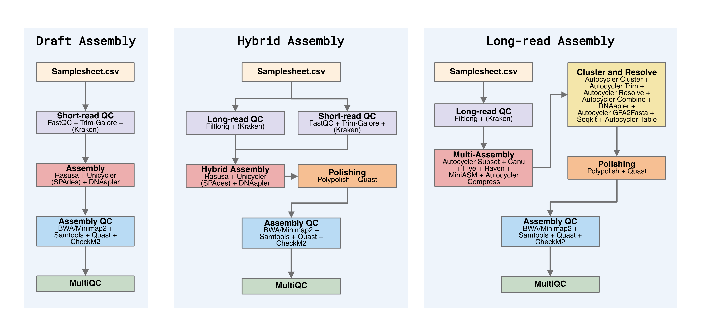

# Summary
Microbial genomics is a rapidly developing field that relies on accurate, high-quality genome assemblies. Generating these assemblies can be challenging, as assembly tools and pipelines are increasing in both number and complexity. Generating optimal assemblies is often a tedious task that requires many manual steps. Assemblage is a Nextflow pipeline designed to make it easier to generate optimal assemblies, allowing users to select tracks based on the available data. The pipeline consists of three assembly tracks: one for short-read data, one for combined short- and long-read data, and one for long-read data. The long-read assembly track assembles high-quality long reads and generates consensus assemblies using Autocycler without manual intervention. The pipeline also includes a subworkflow for genome characterization and plasmid detection. Assemblage is available on GitHub at https://github.com/NorwegianVeterinaryInstitute/Assemblage.

# Statement of need
Generating optimal assemblies has traditionally been a relatively manual process, using tools such as Trycycler [@Wick:2021] and, more recently, Autocycler [@Wick:2025]. While Autocycler was developed to be more automated than Trycycler, it still requires manual steps before the tool can run, such as generating assemblies from read subsets using different assemblers. Assemblage uses Nextflow [@DiTommaso:2017] to automate this process, allowing users to perform all steps required in the Autocycler workflow with a single command. Furthermore, the draft and hybrid assembly tracks are readily available within the same framework, making it easy to generate assemblies using different methods for comparison, which may be crucial when assembling genomes containing plasmids.

# State of the field
Several prokaryotic assembly pipelines exist, some of which are hosted by nf-core [@Ewels:2020]. These include genomeassembler [@genomeassembler] and bacass [@bacass]. The genomeassembler pipeline is designed to assemble only long reads. The bacass pipeline supports different assembly strategies, similar to Assemblage; however, it includes only basic genome annotation. Assemblage includes both general genome annotation with Bakta [@Schwengers:2021] and more specific annotation and characterization tools, such as MOB-suite [@Robertson:2018], AMRFinderPlus [@Feldgarden:2021], VirulenceFinder, and others, within the optional Ellipsis subworkflow. This provides an all-in-one package for complete genome reconstruction and characterization.

# Software design
Assemblage provides three assembly tracks—draft, hybrid, and long-read assembly—and an optional genome characterization subworkflow, Ellipsis. Users select an assembly track based on the sequencing data available (\autoref{fig:figure1}).

The draft assembly track is designed for Illumina short-read data. Read quality is assessed with FastQC [@BabrahamBioinformatics:2018] before and after trimming with Trim-Galore [@Krueger:2023], followed by an optional contamination check with Kraken2. Quality-controlled reads are downsampled to a specified coverage using RaSuSa, then assembled with either Unicycler [@Wick:2017] or SPAdes [@Bankevich:2012]. The resulting contigs are reoriented with DNAApler. Assembly quality is assessed with QUAST [@Gurevich:2013] and CheckM2, and read coverage is calculated using BWA and SAMtools [@Li:2009a]. MultiQC summarizes the assembly statistics and quality-control results in an HTML report.

The hybrid assembly track follows the same short-read preprocessing steps as the draft track and additionally filters low-quality long reads using Filtlong [@Wick:2021a]. Short and long reads are then assembled together using either Unicycler or SPAdes, with the aim of generating complete genome assemblies. The resulting assemblies are polished with Polypolish and assessed with QUAST and CheckM2. Results are summarized in a MultiQC HTML report.

The long-read assembly track is designed to generate high-quality consensus assemblies from high-quality long reads. Autocycler generates read subsets, which are assembled using four assemblers: Canu [@Koren:2017], Flye [@Kolmogorov:2019], Raven, and Miniasm [@Li:2016]. Autocycler then clusters the resulting contigs and combines those that meet the quality thresholds into a consensus assembly. If Illumina reads are also available, they can be used to polish the resulting assemblies. Assembly quality is assessed through read coverage, assembly statistics, and CheckM2, with results summarized in a MultiQC HTML report.

The optional Ellipsis subworkflow uses MOB-suite to predict whether replicons are chromosomes or plasmids, followed by annotation and characterization with Bakta, ResFinder, VirulenceFinder, PlasmidFinder, and AMRFinderPlus. It produces summary text reports for each tool and a combined replicon-level report. By bringing these results together, the combined report facilitates the identification of genes of interest on specific plasmids. This is particularly useful alongside the hybrid and long-read assembly tracks, which are more likely to resolve complete chromosomes and plasmids.

# Research impact statement
Assemblage has been the standard method for generating prokaryotic genome assemblies for research at the Norwegian Veterinary Institute since February 2025. As of October 2026, it has been used across national and international research projects to assemble over 2000 bacterial isolates, ranging from Carbapenemase-producing Enterobacterales to indicator *Escherichia coli*. These assemblies support antimicrobial resistance- and biocide resistance research, identifying the genomic location of specific genes or characterizing resistance plasmids. Additionally, the assemblies support research on avian pathogenic *E. coli*. Assemblage has also been used on selected occasions to generate bacterial genome assemblies for national antimicrobial resistance surveillance in animals, food and feed. Publications arising from some of these projects are currently being developed or under review. 

# AI usage disclosure
Generative AI have been used for minor code generation, as well as general debugging and minor language editing, using GPT-5.3-Codex 0.9x or GPT-6.1 Sol. The authors declare that human authors reviewed, edited, and validated all AI-assisted outputs and made the core design decisions. 

# Acknowledgements

# References